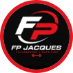

### Experience

-  **Software Engineer** at **[Unbox](https://www.unbox.social/)** · Jan 2026 – present
-  **Full Stack Developer** at **[Avenida+](https://avenidamas.com/)** · 2022 – 2026

### Client work

Side projects for small businesses. Full case studies at [go10.dev](https://go10.dev).

| Project | Scope | Results |
| --- | --- | --- |
|  **[Propiedades El 31](https://go10.dev/work/propiedades-el-31/)** Real estate · 2025 | Back office, API and public site for a Buenos Aires agency. Sole developer, design to deploy. | **3** apps on one data model **135** partidos searchable by distance In production since 2025 |
|  **[Librería San Pablo](https://go10.dev/work/libreria-san-pablo/)** B2B e-commerce · 2026 | B2B store, back office and API, fed weekly from the shop's Visual FoxPro stock table. Sole developer. | **23,040** FoxPro rows imported **6,053** products live **1** file to upload each week |
|  **[Abuelos Burger](https://go10.dev/work/abuelos-burger/)** Restaurant site · 2026 | Menu site where customers build an order and send it as one WhatsApp message. Front-end and ordering flow. | **3** steps from dish to sent order **0** servers holding customer data **7** burgers with real photos |
|  **[FP Jacques](https://go10.dev/work/fp-jacques/)** E-commerce · 2026 | Sports nutrition store, forked from San Pablo's platform and trimmed down. Sole developer. | **1** day from fork to production **7,774** lines of API code removed **25** products, managed by hand |

  <a href="mailto:contacto@go10.dev">contacto@go10.dev</a> · <a href="https://go10.dev">go10.dev</a> · <a href="https://www.linkedin.com/in/mateoleonjacques">LinkedIn</a>

